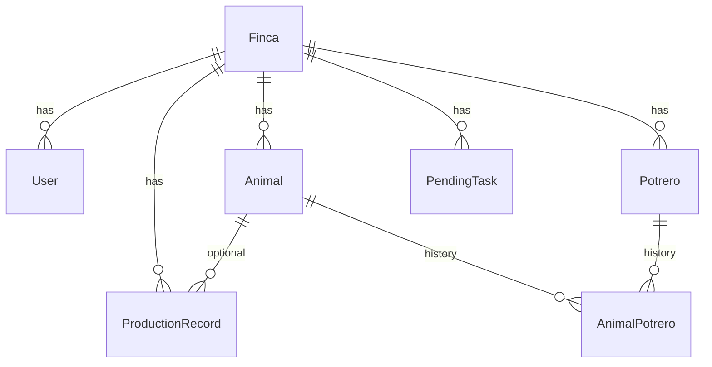

# Base de datos

## Motor

PostgreSQL 16 en Docker (`infra/docker-compose.yml`).

## ER (resumen)



## Comandos

```bash
docker compose -f infra/docker-compose.yml up -d
cd backend
cp .env.example .env
npm install
npx prisma migrate dev --name init   # primera vez (genera migración)
# o: npx prisma migrate deploy      # CI / sin cambios de esquema
npx prisma db seed
```

Adminer: http://localhost:8080 (servidor `postgres`, usuario `agro`, BD `agrocontrol`).

## Esquema

Definido en [`backend/prisma/schema.prisma`](../../backend/prisma/schema.prisma).
