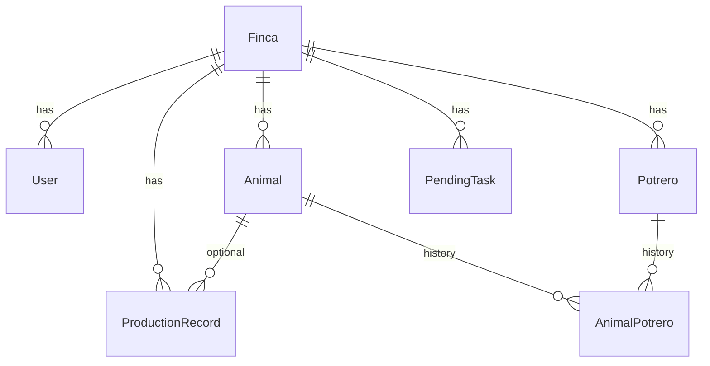

# Base de datos

## Motor

PostgreSQL 16 en Docker (`infra/docker-compose.yml`).

## Credenciales demo (tras seed)

| Campo | Valor |
|-------|--------|
| Usuario API | `demo@agrocontrol.local` |
| Contraseña | `demo1234` |
| PostgreSQL | usuario `agro`, contraseña `agro_secret`, BD `agrocontrol` |

## ER (resumen)



## Comandos

```bash
docker compose -f infra/docker-compose.yml up -d
cd backend
cp .env.example .env
npm install
npm run db:setup
```

- **`npm run db:setup`**: genera cliente Prisma, aplica migraciones (`migrate deploy`) y carga datos semilla (`db seed`).
- **`npm run db:seed`**: solo vuelve a ejecutar el seed (requiere tablas ya creadas).

Adminer: http://localhost:8080 (servidor `postgres`, usuario `agro`, BD `agrocontrol`).

## Esquema y semilla

- Esquema: [`backend/prisma/schema.prisma`](../../backend/prisma/schema.prisma)
- Migración inicial: [`backend/prisma/migrations/20260314140000_init/migration.sql`](../../backend/prisma/migrations/20260314140000_init/migration.sql)
- Datos semilla: [`backend/prisma/seed.ts`](../../backend/prisma/seed.ts) (idempotente, IDs `seed-*`)
