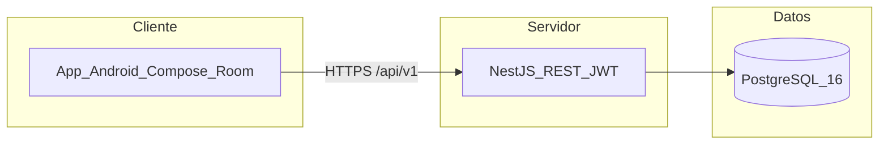
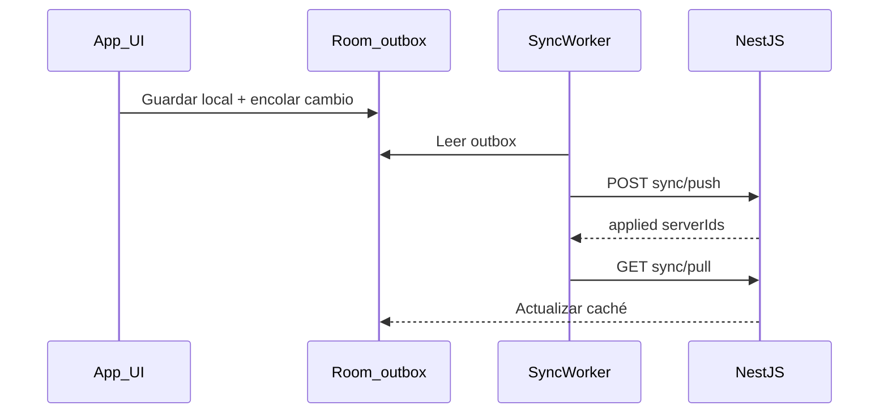

# Arquitectura — overview

## Contenedores (C4 simplificado)



| Contenedor | Responsabilidad |
|------------|-----------------|
| **App Android** | UI Compose, ViewModels, Room (caché + outbox), WorkManager sync, Retrofit |
| **API NestJS** | Auth JWT, CRUD por finca, sync push/pull, dashboard, reportes |
| **PostgreSQL** | Persistencia relacional (Prisma) |

## Despliegue local

```bash
docker compose -f infra/docker-compose.yml up -d
cd backend && npm install && npm run db:setup && npm run start:dev
```

Android Studio: módulo `app`; base URL emulador `http://10.0.2.2:3000/api/v1/`.

Documentación de entrega: [`docs/ENTREGA.md`](../ENTREGA.md).

## Módulos backend

`auth`, `animals`, `paddocks`, `production`, `reproduction`, `tasks`, `reports`, `dashboard`, `sync`.

Catálogo HTTP: [`docs/entrega/BACKEND-API.md`](../entrega/BACKEND-API.md).

## Sync offline-first



Entidades sync: `ANIMAL`, `POTRERO`, `PRODUCTION_RECORD`, `PENDING_TASK`, `REPRODUCTION_EVENT`. Detalle: [`docs/patterns/offline-sync.md`](../patterns/offline-sync.md).

## Multi-tenant (finca)

- Registro → nueva `Finca` + `User`; JWT con `fincaId`.
- APIs filtran por finca del token.
- Semilla demo solo para `demo@agrocontrol.local`.
- Android: al cambiar de cuenta, `LocalTenantClearer` borra Room antes del pull (evita mezclar datos locales).

## App — módulos principales

Tabs: Inicio, Animales, Producción, Potreros, Más. Stack secundario: Pendientes, Perfil, Finanzas, Reportes, Reproducción, formularios CRUD.

Resumen funcional: [`docs/entrega/ANDROID-APP.md`](../entrega/ANDROID-APP.md).
