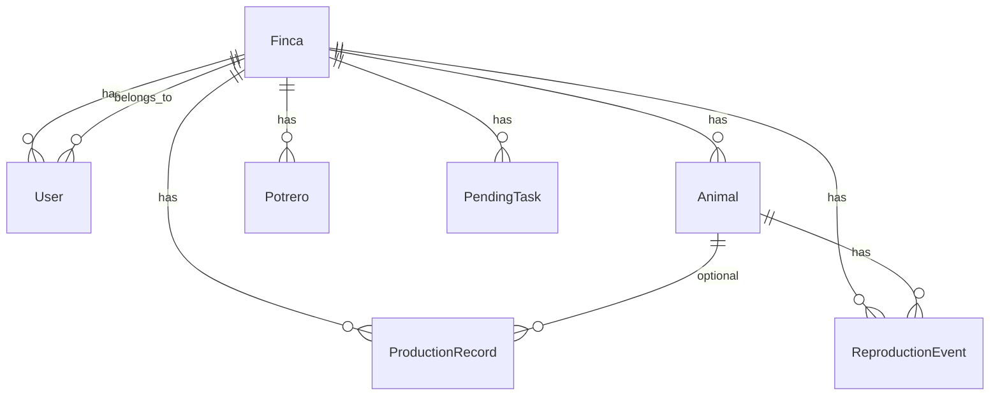

# Backend — API funcional

NestJS + Prisma + PostgreSQL. Prefijo global: **`/api/v1`**. Autenticación: **`Authorization: Bearer <accessToken>`** (salvo auth público).

## Base de datos

### Infraestructura

| Servicio | Archivo | Puerto default |
|----------|---------|----------------|
| PostgreSQL 16 | [`infra/docker-compose.yml`](../../infra/docker-compose.yml) | 5432 |
| Adminer | mismo compose | 8080 |

Credenciales (`.env` / compose): usuario `agro`, contraseña `agro_secret`, BD `agrocontrol`.

### Comandos

```bash
npm run db:setup    # generate + migrate deploy + seed
npm run prisma:deploy
npx prisma migrate status
```

Migraciones en [`backend/prisma/migrations/`](../../backend/prisma/migrations/). Si CRUD live falla con **P2022**, ver troubleshooting en [`backend/README.md`](../../backend/README.md).

### Modelo de datos (resumen)



- **Enums relevantes:** `TaskStatus` (`PENDING`, `COMPLETED`), `ProductType` (`LECHE`, `CARNE`, …), `TaskType` (`POTRERO`, …).
- Esquema completo: [`backend/prisma/schema.prisma`](../../backend/prisma/schema.prisma).

### Multi-tenant y semilla

- Cada **registro** crea `User` + `Finca` nueva (vacía en Postgres).
- JWT incluye `fincaId`; todos los listados filtran por finca del token.
- **Semilla** ([`backend/prisma/seed.ts`](../../backend/prisma/seed.ts)): solo finca `seed-finca-1` y usuario **`demo@agrocontrol.local`** / `demo1234`. Otros usuarios no reciben datos demo.

---

## Catálogo de endpoints

| Módulo | Método | Ruta | Auth | Uso / pantalla app |
|--------|--------|------|------|---------------------|
| **auth** | POST | `/auth/register` | No | Registro |
| | POST | `/auth/login` | No | Login |
| | POST | `/auth/refresh` | No | Renovar token |
| | GET | `/auth/me` | Sí | Perfil (lectura) |
| **dashboard** | GET | `/dashboard/summary` | Sí | Inicio KPIs |
| **animals** | GET | `/animals` | Sí | Lista animales |
| | GET | `/animals/:id` | Sí | Detalle |
| | POST | `/animals` | Sí | Alta (también sync) |
| | PATCH | `/animals/:id` | Sí | Edición |
| | DELETE | `/animals/:id` | Sí | Baja |
| **paddocks** | GET | `/paddocks` | Sí | Potreros |
| | GET | `/paddocks/:id` | Sí | Detalle potrero |
| | POST | `/paddocks` | Sí | Nuevo potrero |
| | PATCH | `/paddocks/:id` | Sí | Editar |
| | PUT | `/paddocks/:id/species` | Sí | Especies permitidas |
| | DELETE | `/paddocks/:id` | Sí | Eliminar |
| **production** | GET | `/production` | Sí | Producción (filtros query) |
| | POST | `/production` | Sí | Registrar |
| | PATCH | `/production/:id` | Sí | Actualizar |
| | DELETE | `/production/:id` | Sí | Eliminar |
| **reproduction** | GET | `/reproduction/summary` | Sí | KPIs reproducción |
| | GET | `/reproduction` | Sí | Eventos |
| | POST | `/reproduction` | Sí | Registrar evento |
| | PATCH | `/reproduction/:id` | Sí | Actualizar |
| | DELETE | `/reproduction/:id` | Sí | Eliminar |
| **tasks** | GET | `/tasks` | Sí | Pendientes (`?status=PENDING`) |
| | POST | `/tasks` | Sí | Crear tarea |
| | PATCH | `/tasks/:id/complete` | Sí | Marcar terminada |
| | DELETE | `/tasks/:id` | Sí | Eliminar |
| **sync** | POST | `/sync/push` | Sí | Outbox Android → servidor |
| | GET | `/sync/pull` | Sí | Delta desde `?since=` ISO |
| **reports** | GET | `/reports/weekly` | Sí | Reportes (`from`, `to`) |
| | GET | `/reports/monthly` | Sí | Reportes (`year`, `month`) |

### Sync — operaciones soportadas en push

Entidades: `ANIMAL`, `POTRERO`, `PRODUCTION_RECORD`, `PENDING_TASK`, `REPRODUCTION_EVENT`. Operaciones: `CREATE`, `UPDATE` (según entidad).

Ejemplo completar tarea offline:

- Outbox: `entity=PENDING_TASK`, `operation=UPDATE`, `serverId=<id>`, `payload={ "status": "COMPLETED" }` → servidor llama a `tasks.complete`.

Detalle: [`docs/patterns/api-contracts.md`](../patterns/api-contracts.md).

---

## Pruebas

| Tipo | Comando | Requisitos | Qué demuestra |
|------|---------|------------|---------------|
| Unitarios | `npm run test` | Node | Servicios con mocks |
| E2E mock | `npm run test:e2e` | Node | **Todas las rutas HTTP** (Supertest, Prisma mock) |
| Smoke live | `npm run test:e2e:live` | Docker + `start:dev` | Login real, sync, dashboard |
| CRUD live | `npm run test:e2e:crud` | Idem | CRUD + lectura en Postgres |

Archivos:

- [`backend/test/endpoints.e2e-spec.ts`](../../backend/test/endpoints.e2e-spec.ts)
- [`backend/test/smoke-live.e2e-spec.ts`](../../backend/test/smoke-live.e2e-spec.ts)
- [`backend/test/crud-live.e2e-spec.ts`](../../backend/test/crud-live.e2e-spec.ts)

---

## Swagger — guion de presentación

1. Abrir **http://localhost:3000/api/docs** (PC, no emulador).
2. **auth → POST /auth/login** — body:
   ```json
   { "email": "demo@agrocontrol.local", "password": "demo1234" }
   ```
3. Copiar `accessToken` → **Authorize** → pegar JWT → Authorize.
4. **GET /auth/me** — nombre, email, finca.
5. **GET /dashboard/summary** — KPIs Inicio.
6. **GET /sync/pull** — snapshot de finca demo (animales, potreros, tareas).
7. (Opcional) **GET /tasks?status=PENDING** y **PATCH /tasks/{id}/complete** — flujo pendientes.

| Endpoint Swagger | Pantalla Android |
|------------------|------------------|
| `GET /dashboard/summary` | Inicio |
| `GET /sync/pull`, `POST /sync/push` | Sync global |
| `GET /auth/me` | Perfil |
| `GET /tasks` | Pendientes |
| `GET /reports/weekly` | Reportes |

Errores frecuentes: **401** → token expirado (volver a login); emulador usa `10.0.2.2:3000`, Swagger usa `localhost:3000` (misma API).

---

## Postman / Insomnia / OpenAPI

- Con API en marcha: **http://localhost:3000/api/docs-json** → Import en Postman o Insomnia.
- Colección lista: [`backend/collections/AgroControl.postman_collection.json`](../../backend/collections/AgroControl.postman_collection.json) — ver [`backend/collections/README.md`](../../backend/collections/README.md).
- Exportar OpenAPI a archivo: `npm run openapi:export` (requiere API levantada).

---

## Documentación relacionada

- Setup y troubleshooting: [`backend/README.md`](../../backend/README.md)
- Entrega general: [`docs/ENTREGA.md`](../ENTREGA.md)
